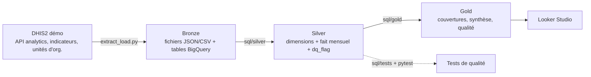

# Data mart de vaccination — DHIS2 → BigQuery

Mini-projet de démonstration : extraire des indicateurs de vaccination d'un serveur DHIS2, les charger dans BigQuery, les modéliser en couches **Bronze → Silver → Gold**, tester leur qualité et les exposer dans un tableau de bord.

> Les données proviennent du serveur de **démonstration public** de DHIS2 (Sierra Leone). Ce sont des données fictives, qui ne reflètent pas la situation réelle du pays.

**Auteur :** _Hamady SISSOKO_ · **Tableau de bord Looker Studio :** https://datastudio.google.com/reporting/482aa28c-e9fe-4340-bdf3-6f4106c832fe

## Architecture



| Couche | Contenu |
|---|---|
| **Bronze** | Données brutes telles qu'extraites, avec date d'extraction et version du serveur (`bronze_extraction_log`) |
| **Silver** | `dim_org_unit`, `dim_indicator`, `fact_indicator_monthly` (grain : indicateur × district × mois, avec `dq_flag`) |
| **Gold** | `gold_coverage_by_district_month`, `gold_district_summary`, `gold_data_quality_summary` |

## Contenu du dépôt

```
extract_load.py          Extraction DHIS2 et chargement Bronze (BigQuery)
run_sql.py               Exécute Silver, Gold et les tests SQL dans BigQuery
sql/silver, sql/gold     Transformations (BigQuery SQL)
sql/tests                Tests SQL : chacun doit retourner 0 ligne
tests/                   Tests pytest sur les fichiers Bronze (sans BigQuery)
data/bronze/2026-10-22   Extraction figée utilisée pour ce projet
docs/                    Constats de qualité des données, guide du tableau de bord
```

## Reproductibilité

L'extraction figée dans `data/bronze/2026-10-22/` vient du serveur `https://play.im.dhis2.org/dev` (version **2.44-SNAPSHOT**, révision `61377d1`, extrait le 2026-10-22). Ce serveur de développement change souvent : une nouvelle extraction ne redonnera pas exactement les mêmes chiffres. C'est pourquoi les fichiers sont versionnés dans le dépôt et `system_info.json` est conservé.

## Démarrage rapide

```bash
pip install -r requirements.txt

# 1. Tests sur les données figées (aucun compte nécessaire)
pytest -q

# 2. Nouvelle extraction (identifiants de démo publics, voir la documentation DHIS2)
export DHIS2_URL=https://play.im.dhis2.org/dev
export DHIS2_USER=admin
export DHIS2_PASSWORD=district
python extract_load.py --from-dir data/bronze/2026-10-22 --load                # écrit data/bronze/<date>/

# 3. BigQuery (sandbox gratuit suffisant)
gcloud auth application-default login
export BQ_PROJECT=mon-projet BQ_DATASET=vaccination_bronze BQ_LOCATION=US
python extract_load.py --load         # couche Bronze
python run_sql.py                     # Silver, Gold, puis tests SQL
```

Sous PowerShell, remplace `export VAR=valeur` par `$env:VAR = "valeur"`.

## Indicateurs

16 indicateurs exploitables : couvertures BCG, Penta 1 à 3, OPV 0 à 3, rougeole, enfants complètement vaccinés (FIC) ; taux d'abandon Penta 1-3 et Penta 1-rougeole ; stocks BCG, OPV, rougeole. Granularité : **13 districts × 12 mois** (octobre 2025 à septembre 2026).

## Qualité des données (résumé)

Sur 2 325 lignes Silver : 2 256 `OK`, 43 stocks négatifs, 17 taux d'abandon négatifs, 9 couvertures supérieures à 100 %. Complétude de 91,7 % à 100 % selon l'indicateur (en général 145 lignes sur 156 attendues). Un indicateur (`FIC <1y - Adjusted for reporting`) vaut 0 partout à cause d'une erreur dans sa définition et il est exclu. Détails et explications dans [`docs/data_quality_findings.md`](docs/data_quality_findings.md).

Les anomalies sont **signalées, pas corrigées** : la valeur brute est conservée et un `dq_flag` l'accompagne.

## Limites et choix

- Les moyennes de `gold_district_summary` sont des moyennes simples des valeurs mensuelles, non pondérées par la population cible.
- Aucune ligne au niveau national : l'extraction est faite par district. Une couverture nationale ne se calcule pas en moyennant les districts, il faut agréger numérateurs et dénominateurs (non extraits ici).
- Les indicateurs de couverture sont annualisés dans DHIS2 (voir `dim_indicator.annualized`) : une valeur mensuelle se lit avec cette précaution.
- Dans le sandbox BigQuery, les tables expirent par défaut après 60 jours : les fichiers du dépôt permettent de tout recharger.
- Les tests SQL ont été vérifiés par transpilation vers DuckDB sur les données du dépôt, et leur syntaxe BigQuery a été validée. La première exécution sur BigQuery : les couches Silver et Gold et les 7 tests SQL ont été exécutés avec succès sur BigQuery (22 octobre 2026), après une vérification préalable de la logique sur DuckDB.

## Source des données

DHIS2, serveur de démonstration public (play.im.dhis2.org). Se référer à la documentation et aux conditions d'utilisation de DHIS2 pour tout réemploi.
